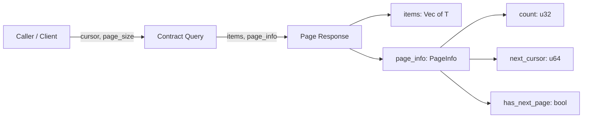
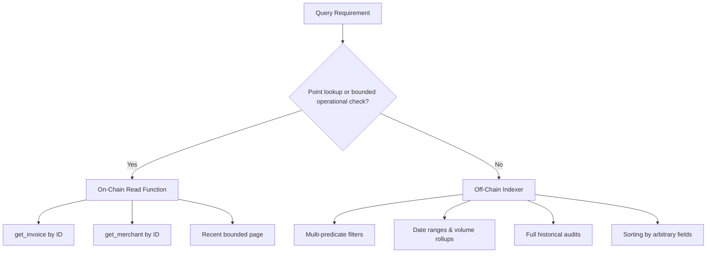

# 0009. Bounded Reads and Pagination Policy

- **Status:** Accepted
- **Date:** 2026-11-24

## Context

On Soroban, every contract invocation executes under rigid resource budgets enforced by the host environment: CPU instructions, memory allocation, transaction payload size, and ledger read/write bytes and entry counts.

Historically, certain contract features and utility functions introduced patterns that violate these resource constraints:
1. **Unbounded storage collections:** Components such as user transaction history stored an append-only `Vec<Transaction>` under a single storage key (`DataKey::UserTransactions(user)`). As usage grows, every subsequent write loads, deserializes, appends to, serializes, and rewrites an ever-larger entry. This scales quadratically in resource cost and inevitably exceeds transaction write-size or gas limits, causing transactions for active users to fail permanently.
2. **Unbounded scans and queries:** List and search queries that scan unbounded sequences or return unpaginated collections risk hitting instruction or read-entry limits as the ledger state accumulates entries, exposing the contract to Denial-of-Service (DoS) failure modes.
3. **Read side effects:** Search and query functions were found emitting informational search events or attempting state mutations. On-chain, this turns view operations into state-altering transactions requiring gas, transaction signatures, and inclusion in ledgers. Furthermore, emitting events on reads pollutes downstream event streams, incurs unexpected RPC simulation costs, and breaks event assertions in integration test suites (as observed during affiliate and search features #349, #350, #351).

To guarantee long-term availability, predictable invocation costs, and safe integration patterns, the contract requires an unambiguous architectural policy governing read boundaries, pagination, storage growth, and off-chain indexing.

## Decision

We establish three strict architectural rules for all contract interfaces, components, and storage models across the workspace:

### Rule 1: Every list-returning function is paginated with a cursor and an enforced maximum page size

- No public contract function may scan or return an unbounded collection.
- All list, history, and search queries must use **keyset / cursor-based pagination**. Offset-based pagination (`offset`/`limit` or `skip`) is prohibited because skipping entries requires linear `O(N)` storage scans that degrade as the dataset expands.
- Contract endpoints must enforce a strict maximum page size (`MAX_PAGE_SIZE`, standard: 50 items). If a caller supplies a `page_size` exceeding `MAX_PAGE_SIZE` or specifies `0`, the function must clamp the page size to the enforced limit (or reject invalid arguments).
- Iteration during query filtering must be bounded by both the requested page limit and a safe maximum scan budget to prevent unbounded loop traversal across filtered-out records.

### Rule 2: No storage entry may grow with usage

- Collections (`Vec`, `Map`, `Set`) that accumulate elements over time must never be stored under a single storage key.
- All scalable entities must be stored as individually addressable persistent entries keyed by a monotonic identifier or compound key (e.g., `DataKey::Invoice(u64)`, `DataKey::UserTransaction(Address, u64)`), accompanied by a dedicated counter (e.g., `DataKey::InvoiceCount`).
- The storage footprint of any single entry must remain constant `O(1)` in size throughout the contract lifecycle.

### Rule 3: Read functions do not emit events or write storage

- Read functions (`get_*`, `search_*`, `query_*`, `list_*`) must be strictly pure views: they must execute zero storage writes (in persistent, instance, or temporary storage) and must emit zero contract events.
- Read functions must not invoke `extend_ttl`; TTL extensions are strictly reserved for state-mutating execution paths or operator upkeep as defined in [Storage Model](../storage-model.md) and ADR 0008 (Storage TTL Strategy).
- Any client must be able to simulate read calls via Soroban RPC without transaction fees, without signing authorization, and without generating spurious event logs.

---

## Standard pagination shape

All paginated public functions in the workspace standardize on the keyset pagination pattern established by `InvoicePage` and `PageInfo` (used for [invoices](../../glossary.md#invoice) and [merchants](../../glossary.md#merchant)) in [`contracts/shade/src/types.rs`](../../../contracts/shade/src/types.rs):

The standard keyset pagination data flow between client queries and contract response types:



### Keyset metadata: `PageInfo`

Every paginated response includes a metadata struct providing cursor progression:

```rust
/// Keyset pagination metadata returned with paginated query results.
#[contracttype]
#[derive(Clone, Debug, Eq, PartialEq)]
pub struct PageInfo {
    /// Number of items returned in the current page.
    pub count: u32,
    /// ID of the last item in this page; pass as `cursor` in the next call.
    /// `0` indicates there are no more pages.
    pub next_cursor: u64,
    /// True if additional matching records exist beyond this page.
    pub has_next_page: bool,
}
```

### Page container shape

List query responses wrap the collection and `PageInfo` in a dedicated contract type named `<Entity>Page`:

```rust
/// A paginated slice of invoices matching a query filter.
#[contracttype]
#[derive(Clone, Debug, Eq, PartialEq)]
pub struct InvoicePage {
    pub items: Vec<Invoice>,
    pub page_info: PageInfo,
}
```

### Pagination protocol semantics

| Parameter / Field | Type | Semantics |
|---|---|---|
| `cursor` (input) | `u64` | Identifier of the last item received from the previous page. Pass `0` to request the initial page. Query scans begin strictly after `cursor` (exclusive). |
| `page_size` (input) | `u32` | Number of items requested by the caller. Automatically clamped to `MAX_PAGE_SIZE` (default 50). |
| `items` (output) | `Vec<T>` | Bounded list of results matching the query (length `<= page_size`). |
| `count` (output) | `u32` | Exact number of elements in `items`. |
| `next_cursor` (output) | `u64` | Identifier of the last item in `items`. If `has_next_page` is false, this must be `0`. |
| `has_next_page` (output) | `bool` | `true` if at least one matching item remains after `next_cursor`; `false` if the end of results has been reached. |

---

## When to use an indexer vs. on-chain queries

On-chain query capabilities are intentionally constrained. The contract does not provide a relational query engine or full-text search. Workloads must be routed according to the following boundary:

Decision boundary determining when queries belong on-chain versus in an off-chain indexer:



### On-chain queries (contract responsibility)

On-chain queries are strictly suitable for:
- Direct, point-in-time lookups of a single entity by its primary key (e.g., `get_invoice(id)`, `get_merchant(id)`).
- Critical state assertions invoked directly by another smart contract during transaction execution.
- Small, bounded verification checks required for immediate operational steps by the caller (e.g., fetching the first page of active records with a small page size).

### Off-chain indexers (indexer responsibility)

All secondary, exploratory, or analytical querying must be delegated to off-chain indexers (such as Mercury, Goldsky, SubQuery, or custom ingestion pipelines consuming Stellar RPC `getEvents`):
- **Complex filtering:** Queries filtering across multiple non-key fields (e.g., invoices matching status `Paid`, created within a specific timestamp window, denominated in a specific token).
- **Sorting and ordering:** Ordering results by amount, creation date, settlement timestamp, or merchant name.
- **Aggregations and analytics:** Calculating cumulative revenue, volume summaries, daily settlement totals, or customer retention metrics.
- **Deep historical inspection:** Retrieving full transaction histories, audit logs, or paginating through thousands of historical invoices.
- **Full-text and search indexing:** Searching by merchant name strings, invoice descriptions, or external references.

The contract's responsibility to off-chain indexers is to emit structured, typed events during state-mutating transactions (e.g., `invoice_created`, `invoice_paid`, `refund_issued`). Indexers consume this event log to maintain query-optimized relational or document databases without placing compute or storage burdens on the Stellar ledger.

---

## Consequences

- **Predictable execution and gas costs:** By capping page sizes and eliminating unbounded scans, contract read operations remain reliably within transaction resource limits.
- **Storage sustainability:** Normalizing collections into `O(1)` keyed entries prevents permanent contract degradation or account lockups caused by oversized storage writes.
- **Zero-cost client simulation:** Ensuring read functions produce no state writes or events allows clients and dApp frontends to simulate queries for free over RPC without gas or wallet signatures.
- **Architectural clarity:** Establishes a definitive separation between on-chain settlement logic and off-chain data querying, guiding future feature development away from complex in-contract search routines.
- **DApp integration requirement:** DApps and dashboards requiring complex queries, sorting, or historical lists must connect to an off-chain indexer rather than relying on on-chain view functions.

---

## Alternatives considered

- **Offset-based pagination (`offset` / `limit`):**
  - *Why rejected:* Offset pagination requires traversing and skipping `N` entries on each page request. In a ledger environment, this incurs `O(N)` storage read costs and CPU instruction consumption, which degrades significantly as `offset` increases and risks out-of-gas failures on deep pages.
- **Unbounded collections with runtime warnings or soft caps:**
  - *Why rejected:* Soft caps are easily breached or bypassed by feature extensions. Unbounded vectors in storage eventually hit Soroban ledger entry size limits (64 KB) or transaction write-byte limits, resulting in unrecoverable state failure for active users.
- **Emitting search telemetry events from read queries:**
  - *Why rejected:* Emitting events turns a read function into a state-mutating transaction when executed on-chain. This requires caller transaction fees, generates noisy event data that degrades indexer efficiency, and breaks contract unit tests that verify event emissions strictly for business state transitions.
