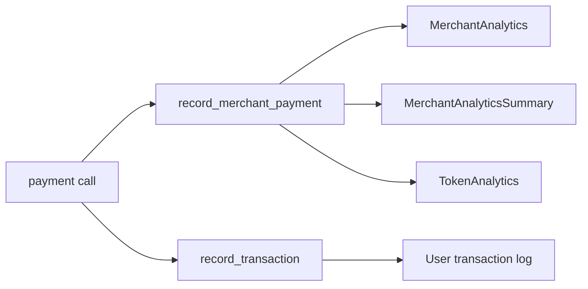

# Merchant analytics and transaction history

The Shade contract accumulates per-[merchant](../glossary.md#merchant), per-token analytics and a per-user transaction log on-chain. This page documents what is tracked, how to read it, and what it does not cover.

## Why it exists

[Merchants](../glossary.md#merchant) and integrators need visibility into on-chain payment volume, fee revenue, and transaction history without relying solely on external indexers. The analytics system provides a read-optimized summary that can be queried directly from the contract.

## How it works

### Analytics recording

Every successful invoice payment calls `record_merchant_payment`, which atomically updates three analytics stores:

1. **Per-merchant, per-token** (`MerchantAnalytics`) — volume, fees, and count for a specific merchant and token pair.
2. **Per-merchant summary** (`MerchantAnalyticsSummary`) — aggregated across all tokens for a given merchant.
3. **Per-token global** (`TokenAnalytics`) — volume, fees, count, and a merchant-count counter for that token. The counter has a [known limitation](#tokenanalytics-fields); do not read it as a distinct-merchant count.

### Transaction history

Every payment also records a `Transaction` entry in the user's transaction log via `record_transaction`. The log is append-only, but no storage entry grows with it: each transaction is its own entry (`UserTransaction(user, index)`, indexes start at 1) and `UserTransactionCount(user)` holds how many exist. Recording a payment writes two small entries however long the history is.

#### Reading history

`get_user_transactions_page(user, cursor, page_size)` returns a `TransactionPage` (`items` plus `page_info`), oldest first:

- Pass `cursor = 0` for the first page; pass `page_info.next_cursor` for each following page.
- A `page_size` of 0, or above the maximum of 50, is treated as 50.
- `page_info.has_next_page` is `false` on the last page, and `next_cursor` is then `0`.
- `get_user_transaction_count(user)` returns the total.

`get_user_transactions(user)` is deprecated. It returns only the first page (at most 50 transactions).

#### Decision: on-chain history and indexers

The contract keeps a bounded, paginated on-chain history for recent and point reads. Full historical audits, filtering and analytics belong in an off-chain indexer that consumes contract events, as set out in [ADR 0009](../architecture/decisions/0009-bounded-reads-and-pagination.md).

History recorded before this change was stored under the legacy `UserTransactions` key. The contract no longer reads or writes that key, so a deployment with existing history needs a one-off migration to appear in the paginated reads.

## Relevant types and storage

| Type / key | Defined in | Purpose |
|---|---|---|
| `MerchantAnalytics` | [`contracts/shade/src/types.rs#L175-L182`](../../contracts/shade/src/types.rs) | Per-merchant, per-token volume, fees, and count |
| `MerchantAnalyticsSummary` | [`contracts/shade/src/types.rs#L186-L192`](../../contracts/shade/src/types.rs) | Per-merchant aggregate across all tokens |
| `TokenAnalytics` | [`contracts/shade/src/types.rs#L204-L211`](../../contracts/shade/src/types.rs) | Global per-token volume, fees, count, and merchant counter |
| `Transaction` | [`contracts/shade/src/types.rs#L223-L231`](../../contracts/shade/src/types.rs) | Individual transaction record |
| `TransactionType` | [`contracts/shade/src/types.rs#L216-L219`](../../contracts/shade/src/types.rs) | `InvoicePayment` in current flows; `SubscriptionCharge` is defined but unused |

### MerchantAnalytics fields

| Field | Type | When incremented |
|---|---|---|
| `total_volume` | `i128` | Each `record_merchant_payment` call by `volume_amount` |
| `total_fees` | `i128` | Each `record_merchant_payment` call by `fee_amount` |
| `transaction_count` | `u64` | Each `record_merchant_payment` call by 1 |
| `last_updated` | `u64` | Set to current ledger timestamp on each update |

### MerchantAnalyticsSummary fields

| Field | Type | When incremented |
|---|---|---|
| `total_volume` | `i128` | Sum of all per-token volumes for the merchant |
| `total_fees` | `i128` | Sum of all per-token fees for the merchant |
| `transaction_count` | `u64` | Sum of all per-token counts for the merchant |
| `last_updated` | `u64` | Set to current ledger timestamp on each update |

### TokenAnalytics fields

| Field | Type | When incremented |
|---|---|---|
| `total_volume` | `i128` | Sum of all merchants' volume for this token |
| `total_fees` | `i128` | Sum of all merchants' fees for this token |
| `transaction_count` | `u64` | Sum of all merchants' transaction counts for this token |
| `unique_merchants` | `u64` | Merchant counter; see the warning below |
| `last_updated` | `u64` | Set to current ledger timestamp on each update |

> **Warning:** `TokenAnalytics.unique_merchants` is not a distinct-merchant count. `record_token_payment` increments it only when the token's stored volume is `0` before the payment, so it is `1` for any token that has recorded a payment. Count distinct merchants from events. See [Token analytics and market share metrics](token-analytics.md#tokenanalytics-fields) for details.

### Transaction fields

| Field | Type | Description |
|---|---|---|
| `transaction_type` | `TransactionType` | `InvoicePayment` in current flows |
| `ref_id` | `u64` | Invoice ID |
| `amount` | `i128` | Payment amount |
| `token` | `Address` | Token used for payment |
| `description` | `String` | Human-readable description |
| `date` | `u64` | Ledger timestamp of the transaction |
| `merchant_id` | `u64` | ID of the [merchant](../glossary.md#merchant) |

## Relevant functions

| Function | Defined in | Purpose |
|---|---|---|
| `record_merchant_payment` | [`contracts/shade/src/components/analytics.rs#L42-L77`](../../contracts/shade/src/components/analytics.rs) | Update analytics after a payment |
| `get_merchant_volume` | [`contracts/shade/src/components/analytics.rs#L7-L9`](../../contracts/shade/src/components/analytics.rs) | Read total volume for a merchant/token pair |
| `get_merchant_analytics` | [`contracts/shade/src/components/analytics.rs#L11-L27`](../../contracts/shade/src/components/analytics.rs) | Read full analytics for a merchant/token pair |
| `get_merchant_analytics_summary` | [`contracts/shade/src/components/analytics.rs#L29-L40`](../../contracts/shade/src/components/analytics.rs) | Read aggregated analytics across all tokens |
| `get_token_analytics` | [`contracts/shade/src/components/analytics.rs#L79-L91`](../../contracts/shade/src/components/analytics.rs) | Read global token analytics |
| `get_user_transactions` | [`contracts/shade/src/components/history.rs#L17-L22`](../../contracts/shade/src/components/history.rs) | Read full transaction log for a user |

## What analytics do not cover

- **Refund adjustments.** Refunds do not reduce `total_volume`, `total_fees`, or `transaction_count`. The analytics reflect gross activity, not net.
- **Off-chain activity.** Payments settled entirely off-chain or through external systems are invisible to on-chain analytics.
- **Expired or pruned data.** On-chain data persists indefinitely; there is no automatic pruning. The `last_updated` field indicates freshness but does not expire.

## On-chain analytics vs. event indexing

| Approach | Cost | Freshness | Completeness |
|---|---|---|---|
| On-chain read (`get_merchant_analytics`) | Low — single contract read | Real-time | Only aggregated summaries |
| Event indexing | Higher — requires off-chain infrastructure | Near real-time | Full event stream with every field |

Use on-chain analytics for dashboards, quick queries, and verification. Use event indexing when you need per-event granularity, historical replay, or cross-contract correlation.

> **Note:** The `last_updated` field is set on every payment. If a [merchant](../glossary.md#merchant) has no recent activity, the timestamp reflects the last payment, not the current time.

## How analytics are tested

The suite in [`test_analytics_aggregation.rs`](../../contracts/shade/src/tests/test_analytics_aggregation.rs) drives real invoice payments through a mock Stellar environment and checks the three analytics views after each scenario. It covers cumulative volume and fees, per-token and per-merchant isolation, `last_updated` accuracy, discount interactions, refund immutability, and zero-amount rejection.

Read the [Analytics test suite](../getting-started/analytics-tests.md) page for the complete 16-test inventory, related tests, and the commands to run a subset.

## Related pages

- [Analytics test suite](../getting-started/analytics-tests.md) — verified inventory of the analytics tests and how to run them.
- [Token analytics and market share metrics](token-analytics.md)
- [Invoices and payment](payment-payloads-and-routing.md)
- [Auto-withdrawal and merchant settlement](auto-withdrawal.md)
