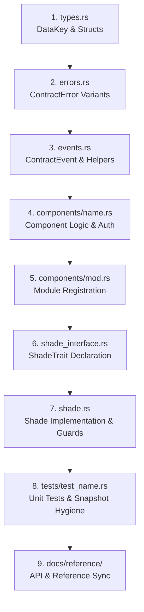

# Adding a Component to Shade

A step-by-step tutorial for contributors implementing a new component in the `shade` contract hub.

## Overview

Most feature contributions to the Shade gateway involve adding business logic to the `shade` contract hub (`contracts/shade/`). Because `shade` coordinates merchant accounts, invoices, fees, and payments, code is organized modularly using the [component pattern](../architecture/component-pattern.md).

Rather than writing monolithic contract files, every feature touches a fixed set of files in a strict order:


*Order of implementation when adding a new component to the `shade` contract.*

This tutorial walks through building a complete toy feature — **per-merchant notes** (`merchant_notes`) — from start to finish. The notes feature lets a [merchant](../glossary.md#merchant) attach a descriptive note to their profile and allows anyone to query it by merchant ID.

---

## File Responsibilities

| File | Purpose | Key Rules |
|---|---|---|
| [`contracts/shade/src/types.rs`](../../contracts/shade/src/types.rs) | Defines storage keys in `DataKey` and data transfer structures. | Keep keys in persistent storage; respect Soroban's 50-variant limit on enum types. |
| [`contracts/shade/src/errors.rs`](../../contracts/shade/src/errors.rs) | Defines contract panic error codes in `ContractError`. | Append-only: never renumber or delete existing error variants. |
| [`contracts/shade/src/events.rs`](../../contracts/shade/src/events.rs) | Defines `#[contractevent]` structs and publish helpers. | Publish events after state writes make them true; include relevant IDs and timestamps. |
| `contracts/shade/src/components/<name>.rs` | Implements business logic, auth checks, and storage access. | Plain functions (`pub fn`); take `&Env` as first parameter; assert auth here. |
| [`contracts/shade/src/components/mod.rs`](../../contracts/shade/src/components/mod.rs) | Declares component modules within `components::`. | Register `pub mod <name>;`. |
| [`contracts/shade/src/shade_interface.rs`](../../contracts/shade/src/shade_interface.rs) | Declares the public contract trait `ShadeTrait`. | Method signatures take owned `Env`; no function bodies. |
| [`contracts/shade/src/shade.rs`](../../contracts/shade/src/shade.rs) | Implements `ShadeTrait for Shade`. | Thin delegation layer; applies cross-cutting guards (`assert_not_paused`). |
| `contracts/shade/src/tests/test_<name>.rs` | Unit and integration test suite. | Registers client via `env.register(Shade, ())`; tests edge cases and unauthorized callers. |
| [`contracts/shade/src/tests/mod.rs`](../../contracts/shade/src/tests/mod.rs) | Declares test modules. | Register `pub mod test_<name>;`. |

---

## Step 1: Storage Keys and Types (`types.rs`)

All contract storage keys live in the `DataKey` enum in [`contracts/shade/src/types.rs`](../../contracts/shade/src/types.rs).

1. Define the data structure representing your feature's stored record.
2. Add a matching variant to `DataKey`.

```rust
// contracts/shade/src/types.rs

#[contracttype]
#[derive(Clone, Debug, Eq, PartialEq)]
pub struct MerchantNote {
    pub merchant_id: u64,
    pub note: String,
    pub updated_at: u64,
}

#[contracttype]
#[derive(Clone, Debug, Eq, PartialEq)]
pub enum DataKey {
    // ... existing variants ...
    /// Per-merchant descriptive note stored by merchant ID.
    MerchantNote(u64),
}
```

> **Note:** As detailed in the [Storage Model](../architecture/storage-model.md), all `DataKey` entries in `shade` reside in **persistent storage** (`env.storage().persistent()`).
>
> **Warning:** Soroban enforces a strict maximum of 50 variants on `#[contracttype]` enums. Review the current variant count in `types.rs` before introducing new storage keys.

---

## Step 2: Error Codes (`errors.rs`)

Failure paths in `shade` terminate by panicking with a typed error using `panic_with_error!(env, ContractError::Variant)`.

Open [`contracts/shade/src/errors.rs`](../../contracts/shade/src/errors.rs) and append any error variants needed by your feature:

```rust
// contracts/shade/src/errors.rs

#[contracterror]
#[derive(Copy, Clone, Debug, Eq, PartialEq)]
#[repr(u32)]
pub enum ContractError {
    // ... existing variants ...
    /// The note text exceeds the maximum permitted length.
    NoteTooLong = 53,
    /// No note was found for the specified merchant.
    NoteNotFound = 54,
}
```

> **Warning:** Error codes form part of the permanent contract interface used by client SDKs and indexing pipelines. **Never renumber, reorder, or delete existing error variants.** Always append new variants with a unique numeric discriminant.

---

## Step 3: Events (`events.rs`)

Contract state transitions must emit events so off-chain clients and webhooks can index updates.

In [`contracts/shade/src/events.rs`](../../contracts/shade/src/events.rs), add an event struct annotated with `#[contractevent]` along with a helper function:

```rust
// contracts/shade/src/events.rs

use soroban_sdk::{contractevent, Address, Env, String};

#[contractevent]
pub struct MerchantNoteSetEvent {
    pub merchant: Address,
    pub merchant_id: u64,
    pub note: String,
    pub timestamp: u64,
}

pub fn publish_merchant_note_set_event(
    env: &Env,
    merchant: Address,
    merchant_id: u64,
    note: String,
    timestamp: u64,
) {
    MerchantNoteSetEvent {
        merchant,
        merchant_id,
        note,
        timestamp,
    }
    .publish(env);
}
```

> **Note:** Emit events **after** the storage writes that make them true. Never emit an event prior to validation or fallible storage operations.

---

## Step 4: Component Implementation (`components/<name>.rs`)

Create the component module at `contracts/shade/src/components/merchant_notes.rs`.

Key conventions for component functions:
- Take a borrowed reference `env: &Env` as the first argument.
- Perform caller authentication via `Address::require_auth()` inside the component.
- Validate inputs and assert state invariants. If validation fails, call `panic_with_error!(env, ContractError::...)`.
- Access dependencies via other components' exported functions (such as `merchant::get_merchant_id`), rather than accessing their storage keys directly.
- Paginate list-returning queries using cursor pagination with an enforced maximum page size, ensure no storage collection grows with usage, and ensure read functions emit no events and perform no storage writes (see [ADR 0009](../architecture/decisions/0009-bounded-reads-and-pagination.md)).

```rust
// contracts/shade/src/components/merchant_notes.rs

use crate::components::merchant as merchant_component;
use crate::errors::ContractError;
use crate::events;
use crate::types::{DataKey, MerchantNote};
use soroban_sdk::{panic_with_error, Address, Env, String};

/// Maximum allowed character length for a merchant profile note.
pub const MAX_NOTE_LENGTH: u32 = 500;

/// Set or update the public note for an authorized merchant.
pub fn set_merchant_note(env: &Env, merchant: &Address, note: &String) {
    // 1. Authenticate caller
    merchant.require_auth();

    // 2. Validate input constraints
    if note.len() > MAX_NOTE_LENGTH {
        panic_with_error!(env, ContractError::NoteTooLong);
    }

    // 3. Resolve merchant identity through the merchant component
    let merchant_id = merchant_component::get_merchant_id(env, merchant);

    // 4. Construct record
    let note_data = MerchantNote {
        merchant_id,
        note: note.clone(),
        updated_at: env.ledger().timestamp(),
    };

    // 5. Commit to persistent storage
    env.storage()
        .persistent()
        .set(&DataKey::MerchantNote(merchant_id), &note_data);

    // 6. Publish event once storage write succeeds
    events::publish_merchant_note_set_event(
        env,
        merchant.clone(),
        merchant_id,
        note.clone(),
        env.ledger().timestamp(),
    );
}

/// Retrieve the public note for a merchant by ID.
pub fn get_merchant_note(env: &Env, merchant_id: u64) -> MerchantNote {
    if merchant_id == 0 {
        panic_with_error!(env, ContractError::MerchantNotFound);
    }

    env.storage()
        .persistent()
        .get(&DataKey::MerchantNote(merchant_id))
        .unwrap_or_else(|| panic_with_error!(env, ContractError::NoteNotFound))
}
```

---

## Step 5: Register the Component (`components/mod.rs`)

Add your new module to [`contracts/shade/src/components/mod.rs`](../../contracts/shade/src/components/mod.rs):

```rust
// contracts/shade/src/components/mod.rs

pub mod access_control;
// ...
pub mod merchant;
pub mod merchant_notes; // <-- Register new component
pub mod pausable;
// ...
```

---

## Step 6: Expose the Interface (`shade_interface.rs`)

The contract's exported API surface is defined in [`contracts/shade/src/shade_interface.rs`](../../contracts/shade/src/shade_interface.rs) as `ShadeTrait`.

Declare the signatures for your new functions:

```rust
// contracts/shade/src/shade_interface.rs

use crate::types::MerchantNote;
use soroban_sdk::{contracttrait, Address, Env, String};

#[contracttrait]
pub trait ShadeTrait {
    // ... existing interface methods ...

    /// Set a descriptive note on a merchant's profile.
    fn set_merchant_note(env: Env, merchant: Address, note: String);

    /// Query a merchant's profile note by merchant ID.
    fn get_merchant_note(env: Env, merchant_id: u64) -> MerchantNote;
}
```

> **Note:** Trait methods in `shade_interface.rs` take an owned `env: Env` by Soroban convention, whereas component functions take a borrowed reference `env: &Env`.

---

## Step 7: Wire in the Contract Implementation (`shade.rs`)

[`contracts/shade/src/shade.rs`](../../contracts/shade/src/shade.rs) implements `ShadeTrait for Shade`. It serves as a thin dispatch layer that applies cross-cutting contract guards before delegating to your component.

1. Import your component with a alias (e.g. `merchant_notes as merchant_notes_component`).
2. Implement the trait methods, applying guards where appropriate:

```rust
// contracts/shade/src/shade.rs

use crate::components::{
    // ... existing components ...
    merchant_notes as merchant_notes_component,
    pausable as pausable_component,
};
use crate::types::MerchantNote;

#[contractimpl]
impl ShadeTrait for Shade {
    // ... existing implementations ...

    fn set_merchant_note(env: Env, merchant: Address, note: String) {
        // Apply pause check to state-mutating entrypoints
        pausable_component::assert_not_paused(&env);
        merchant_notes_component::set_merchant_note(&env, &merchant, &note);
    }

    fn get_merchant_note(env: Env, merchant_id: u64) -> MerchantNote {
        // Read-only queries do not require pause guards
        merchant_notes_component::get_merchant_note(&env, merchant_id)
    }
}
```

### Applying Cross-Cutting Guards

| Guard | When to Apply | Implementation |
|---|---|---|
| **Pause Guard** | Every state-changing method (mutating storage, registering entities, updating configs). | `pausable_component::assert_not_paused(&env);` at the top of the `shade.rs` method. |
| **Reentrancy Guard** | Operations involving external token transfers or untrusted callbacks (e.g., payment routing, refunds). | `reentrancy::enter(&env);` before transfers and `reentrancy::exit(&env);` upon completion. |
| **Auth Checks** | Any privileged or identity-bound action. | `caller.require_auth()` **inside** the component function, not in `shade.rs`. |

---

## Step 8: Writing Tests (`tests/test_<name>.rs`)

Create tests in `contracts/shade/src/tests/test_merchant_notes.rs`.

A comprehensive test file covers:
- **Happy path**: Registering a merchant, invoking the new function, and verifying both the returned state and the emitted event.
- **Validation errors**: Passing boundary-violating inputs (e.g., notes that exceed `MAX_NOTE_LENGTH`).
- **Authorization & state guards**: Ensuring non-merchants or uninitialized states panic as expected.

```rust
// contracts/shade/src/tests/test_merchant_notes.rs
#![cfg(test)]

use crate::errors::ContractError;
use crate::shade::{Shade, ShadeClient};
use soroban_sdk::testutils::{Address as _, Events as _};
use soroban_sdk::{Address, Env, String};

fn setup_test() -> (Env, ShadeClient<'static>, Address, Address) {
    let env = Env::default();
    env.mock_all_auths();
    let contract_id = env.register(Shade, ());
    let client = ShadeClient::new(&env, &contract_id);
    let admin = Address::generate(&env);
    client.initialize(&admin);
    (env, client, contract_id, admin)
}

#[test]
fn test_set_and_get_merchant_note_success() {
    let (env, client, _contract_id, _admin) = setup_test();

    let merchant = Address::generate(&env);
    client.register_merchant(&merchant);

    let note_text = String::from_str(&env, "Direct-trade roaster in Portland, OR.");
    client.set_merchant_note(&merchant, &note_text);

    let record = client.get_merchant_note(&1u64);
    assert_eq!(record.merchant_id, 1u64);
    assert_eq!(record.note, note_text);
    assert_eq!(record.updated_at, env.ledger().timestamp());

    // Verify event emission
    let events = env.events().all();
    assert!(!events.is_empty(), "Expected an event to be emitted");
}

#[test]
#[should_panic(expected = "Error(Contract, #53)")]
fn test_set_merchant_note_exceeds_max_length() {
    let (env, client, _contract_id, _admin) = setup_test();

    let merchant = Address::generate(&env);
    client.register_merchant(&merchant);

    // Create a note string exceeding MAX_NOTE_LENGTH (500 chars)
    let long_str = "a".repeat(501);
    let note_text = String::from_str(&env, &long_str);

    client.set_merchant_note(&merchant, &note_text);
}

#[test]
#[should_panic(expected = "Error(Contract, #6)")]
fn test_set_note_non_merchant_fails() {
    let (env, client, _contract_id, _admin) = setup_test();

    let non_merchant = Address::generate(&env);
    let note_text = String::from_str(&env, "Test note");

    // Fails with MerchantNotFound (code 6)
    client.set_merchant_note(&non_merchant, &note_text);
}
```

Register the test module in [`contracts/shade/src/tests/mod.rs`](../../contracts/shade/src/tests/mod.rs):

```rust
// contracts/shade/src/tests/mod.rs

pub mod test_merchant;
pub mod test_merchant_notes; // <-- Register test file
pub mod test_pausable;
```

Run your tests locally:

```bash
cargo test --manifest-path contracts/shade/Cargo.toml test_merchant_notes
```

> **Snapshot Hygiene:** Running tests may generate local snapshot artifacts under `test_snapshots/`. Do **not** commit these files. Ensure your working directory is clean using `git status` prior to staging.

---

## Step 9: Syncing Reference Documentation

To keep documentation accurate for SDK authors and integrators, update the reference docs in the same PR:

1. **Interface Reference:** Add the new signatures to [`docs/reference/shade-interface.md`](../reference/shade-interface.md).
2. **Data Types:** Document your `#[contracttype]` struct in [`docs/reference/data-types.md`](../reference/data-types.md).
3. **Events:** Document the event topic and payload in [`docs/reference/events.md`](../reference/events.md).
4. **Errors:** Document new error codes in [`docs/reference/errors.md`](../reference/errors.md).

---

## Reviewer Checklist

Before submitting your pull request, verify each item against this reviewer-aligned checklist:

- [ ] **Architecture & Layering**
  - Component is in `contracts/shade/src/components/<name>.rs` and registered in `components/mod.rs`.
  - Public functions are declared in `ShadeTrait` (`shade_interface.rs`) and implemented in `shade.rs`.
  - `shade.rs` contains only guard checks and delegations; no complex business logic lives in `shade.rs`.
- [ ] **Authorization & Security**
  - `require_auth()` is called at the top of the component function for caller verification.
  - State-mutating methods apply `pausable_component::assert_not_paused(&env)` in `shade.rs`.
  - Fund-handling paths utilize reentrancy guards (`enter` and `exit`).
- [ ] **Storage & Keys**
  - New storage keys are added to `DataKey` in `types.rs`.
  - Total `DataKey` variant count remains within Soroban's 50-variant limit.
  - Storage operations strictly use persistent storage (`env.storage().persistent()`).
- [ ] **Bounded Reads & Pagination ([ADR 0009](../architecture/decisions/0009-bounded-reads-and-pagination.md))**
  - List-returning functions are paginated with a cursor and an enforced maximum page size (using `PageInfo`).
  - No storage entry grows with usage (no unbounded vectors or maps stored under a single key).
  - Read functions have zero side effects (no storage writes, no `extend_ttl`, and no event emissions).
  - Unbounded history, multi-predicate filtering, and analytical rollups are left to off-chain indexers.
- [ ] **Errors & Events**
  - New error codes are appended to `ContractError` in `errors.rs` with explicit discriminant values; existing codes are unchanged.
  - All fallible conditions fail explicitly via `panic_with_error!(env, ContractError::...)`.
  - State changes emit an event via `events.rs` after storage writes succeed.
- [ ] **Testing & Quality**
  - Unit tests in `contracts/shade/src/tests/` verify both successful execution and expected error panics.
  - Test module is registered in `contracts/shade/src/tests/mod.rs`.
  - Code compiles without warnings (`cargo clippy --workspace --all-features`).
  - Code formatting matches standard style (`cargo fmt --all -- --check`).
  - No `test_snapshots/` artifacts are staged.
- [ ] **Documentation Sync**
  - Reference documentation (`docs/reference/`) reflects all added types, interface methods, events, and error codes.

---

## Related Pages

- [The Component Pattern](../architecture/component-pattern.md) — Structural design and three-file pattern in `shade`.
- [Storage Model](../architecture/storage-model.md) — Key layouts, persistent storage tiers, and ID counter mechanics.
- [Bounded Reads and Pagination Policy](../architecture/decisions/0009-bounded-reads-and-pagination.md) — Pagination standards, storage limits, and indexer delegation rules.
- [Access Control](../security/access-control.md) — Roles, admin privileges, and authorization invariants.
- [Running Tests](../getting-started/running-tests.md) — Running Soroban tests and managing test environments.
- [Contributing Guidelines](../../CONTRIBUTING.md) — Branch naming conventions, PR process, and local pre-commit checks.
