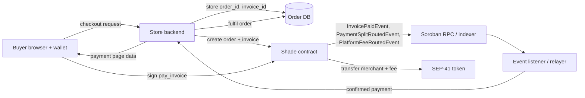

# E-commerce checkout

How to build an online-store checkout on top of Shade: create an invoice from your backend, show a payment page to the buyer, confirm payment from on-chain events, and fulfil or unwind the order safely. This guide is for backend and frontend developers integrating Shade into a store; it composes the lower-level payment, wallet, and indexing guides into one end-to-end flow.

## Prerequisites

- A deployed, initialized `shade` contract with the payment token whitelisted globally and accepted by the merchant — see [Deployment Runbook](../operations/deployment.md) and [Merchant onboarding guide](merchant-onboarding.md).
- A registered merchant with a settlement destination. `pay_invoice` routes the merchant share to the merchant's account contract address; confirm it with `get_merchant_account` before going live.
- A generated TypeScript client or equivalent Soroban RPC integration — see [Generating and using contract bindings](contract-bindings.md).
- A browser wallet integration for the buyer-facing payment step — see [Wallet integration guide](wallet-integration.md).
- An event ingestion path for confirmation — see [Event indexing guide](indexing-events.md) and [Webhooks](webhooks.md).

> **Note:** This guide describes application architecture and integration patterns. The `shade` contract stores invoices, validates payments, and emits events; it does not create orders, call your webhook, or mark items shipped.

## Architecture

| Component | Responsibility | Trust boundary |
|---|---|---|
| Store backend | Creates orders, creates/finalizes invoices, stores `order_id <-> invoice_id`, fulfils orders after confirmed payment | Trusted by the store; must not expose admin/manager keys to browsers |
| Shade hub contract | Owns invoice state, validates payment rules, transfers tokens, emits payment events | On-chain source of truth for payment state |
| Payer wallet | Holds buyer keys, reviews transaction, signs `pay_invoice` / `pay_invoice_partial` | Buyer-controlled; never receives store secrets |
| Event listener / webhook relayer | Reads `getEvents`/RPC results, deduplicates, updates order state, delivers internal notifications | Off-chain observer; must treat RPC data as input to verify, not as an authority over chain state |



The confirmation path is asynchronous from the buyer's browser. The browser can show "submitted" after a successful wallet submission, but the store backend should fulfil only after an independent confirmation path observes the payment and verifies the invoice on-chain.

## 1. Create the order and invoice

Create the order in your own database first, or create it in a pending state that can be reconciled against invoice creation. The store backend, not the browser, should own invoice creation because the backend decides amount, token, expiry, and order mapping.

### Standard invoice creation

Use `create_invoice` when the order amount is already denominated in the payment token:

```rust
fn create_invoice(
    env: Env,
    merchant: Address,
    description: String,
    amount: i128,
    token: Address,
    expires_at: Option<u64>,
) -> u64;
```

`create_invoice` requires merchant authorization (`merchant.require_auth()`), validates the merchant/token/amount, and creates a `Pending` invoice. The returned `u64` is the `invoice_id` you store against the order.

### Signed/server-mediated invoice creation

Use `create_invoice_signed` only when your flow intentionally uses Shade's signed-invoice path. It is **not** a generic "backend can create invoices without auth" endpoint:

```rust
fn create_invoice_signed(
    env: Env,
    caller: Address,
    merchant: Address,
    description: String,
    amount: i128,
    token: Address,
    nonce: BytesN<32>,
    signature: BytesN<64>,
) -> u64;
```

Important constraints from the implementation (`contracts/shade/src/components/invoice.rs`):

- `caller` must have `Role::Manager` or `Role::Admin`; otherwise it panics `NotAuthorized`.
- `caller.require_auth()` is enforced.
- The merchant's cryptographic signature is verified against the merchant key, description, amount, token, and nonce.
- The nonce is consumed; reusing it fails.

For most e-commerce stores, standard merchant-authorized `create_invoice` is simpler. Use `create_invoice_signed` when you have an explicit manager/admin operator model and a merchant-signature workflow.

### Draft/finalize option

If the order can be edited before it becomes payable, create a draft with `create_invoice_draft` and call `finalize_invoice` when the order is locked. Draft invoices are not payable until finalized.

### Store the invoice mapping

Persist at least:

```text
orders
  id (internal order id, primary key)
  merchant_id
  shade_invoice_id (unique, nullable until created)
  payment_token
  expected_amount
  currency / pricing_mode
  status (pending_payment | partially_paid | paid | expired | cancelled | refunded | review)
  created_at
  updated_at

order_payments
  idempotency_key (primary key)
  order_id
  invoice_id
  payer
  amount
  fee
  merchant_amount
  token
  ledger
  tx_hash
  event_index
  confirmed_at
```

Make `shade_invoice_id` unique. If invoice creation is retried after an uncertain RPC response, resolve the ambiguity before creating another payable invoice for the same order.

## 2. Build the payment page

The payment page should display data from the contract, not only from your database.

### Load invoice state

```ts
const { result: invoice } = await shade.get_invoice({ invoice_id: invoiceId });
const { result: resolvedAmount } = await shade.resolve_invoice_amount({ invoice_id: invoiceId });
```

`resolve_invoice_amount` returns the live payable amount. For `FixedCrypto` invoices it returns the stored amount. For `FixedFiat` invoices it re-resolves from the oracle while `amount_paid == 0`; after the first payment lands, it returns the stored amount because the invoice's crypto amount is frozen.

### Display to the buyer

Show:

- Invoice/order identifier and merchant identity.
- `resolvedAmount`, token, and remaining balance (`invoice.amount - invoice.amount_paid`).
- `status` and `expires_at`.
- A clear warning for fiat-priced invoices that the final on-chain amount is re-resolved at payment time until the first payment settles.
- Network name and contract ID in development/admin views; avoid making buyers debug raw contract errors.

### Pre-submit checks

Before opening the wallet:

1. Refresh `get_invoice` and `resolve_invoice_amount`.
2. Reject locally if status is not `Pending` or `PartiallyPaid`.
3. Reject locally if `expires_at` is in the past.
4. Check payer token balance, trustline/SAC prerequisites, and XLM fee reserve as described in [Wallet integration guide](wallet-integration.md).

### Pay from the buyer wallet

For a full remaining payment:

```ts
const tx = await shade.pay_invoice({ payer: buyerAddress, invoice_id: invoiceId });
await tx.signAndSend({ signTransaction: walletSigner });
```

For a partial payment:

```ts
const tx = await shade.pay_invoice_partial({
  payer: buyerAddress,
  invoice_id: invoiceId,
  amount: partialAmount,
});
await tx.signAndSend({ signTransaction: walletSigner });
```

`pay_invoice` and `pay_invoice_partial` require the `payer` argument to authorize the invocation. Shade routes the token transfer from the payer to the merchant account and platform account; the payer does not need a prior `token.approve` for this flow.

## 3. Confirm payment

Do not mark an order fulfilled only because `signAndSend` returned in the browser. Use an independent confirmation path.

### Confirmation sources

| Source | Use | Limitation |
|---|---|---|
| Browser submit result | Show "submitted / awaiting confirmation" | User can close tab; RPC response can be lost; not authoritative for fulfilment |
| `get_invoice` read | Verify current on-chain status and amounts | Point-in-time read; still needs idempotent processing |
| Event stream (`getEvents`) | Build durable payment ledger and trigger fulfilment | RPC retention window is limited; requires cursor persistence and backfill |
| Webhook relayer | Push confirmed events into internal systems | Delivery is at-least-once; verify signature and dedupe |

### Recommended confirmation rule

Treat a payment as confirmed for fulfilment only when all of these are true:

1. You observed an `InvoicePaidEvent` or equivalent confirmed transaction result for the expected `invoice_id`.
2. The event/tx is from the expected `shade` contract and network.
3. The idempotency key has not been processed before.
4. A fresh `get_invoice(invoice_id)` read shows the expected state (`Paid`, or `PartiallyPaid` with expected cumulative `amount_paid`).

For full order fulfilment, require `invoice.status == Paid` and `amount_paid == amount`.

### Events to consume

The payment path emits:

- `InvoicePaidEvent` — invoice/payment identity, payer, gross amount, fee, merchant amount, token.
- `PaymentSplitRoutedEvent` — merchant/platform split for the invoice payment.
- `PlatformFeeRoutedEvent` — canonical fee-routing record across payment domains; `route_kind` distinguishes invoice/subscription/ticket routes.

`pay_invoice` and `pay_invoice_partial` emit the same `InvoicePaidEvent` shape. There is no separate `InvoicePartiallyPaidEvent`; derive partial vs final from `Invoice.status` or by comparing `amount_paid` and `amount`.

## 4. Handle failure cases

### Partial payments

- Accepted when invoice status is `Pending` or `PartiallyPaid`.
- Rejected with `InvalidAmount` if amount is <= 0 or would exceed remaining balance.
- `InvoicePaidEvent` is emitted for each successful partial payment.
- Keep the order in `partially_paid` until `get_invoice` shows `Paid`.
- Multiple payers are not supported for the same invoice: the first payer is recorded; a different payer causes `NotAuthorized`.

### Overpayments

Shade does not accept overpayment on invoice payment calls. `pay_invoice_partial` rejects `amount_paid + amount > invoice.amount` with `InvalidAmount`. Do not build an "extra amount will be refunded automatically" flow around invoice overpayment; it is rejected before settlement.

### Expiry

- If `expires_at` is set and `ledger.timestamp >= expires_at`, payment panics `InvoiceExpired`.
- Expired invoices are not automatically paid or cancelled by a background contract job; your backend should transition the order based on observed time/state and create a new invoice if the buyer still wants to pay.
- For fiat-priced invoices, also treat client-side quotes as short-lived; re-resolve before submission.

### Refunds

- `refund_invoice` and `refund_invoice_partial` are merchant-authorized refund paths.
- `claim_refund` is buyer-authorized for refund flows where the contract allows the buyer to claim.
- Refund events are `InvoiceRefundedEvent` and `InvoicePartiallyRefundedEvent`.
- A refund moves money back on-chain but does not reverse your off-chain fulfilment. Your order system needs an explicit refund/return/cancellation policy.

### Failed or uncertain submissions

| Case | What to do |
|---|---|
| Wallet rejected signature | Keep order pending; no chain state changed. |
| Simulation failed | Show mapped error; do not fulfil. |
| Submit returned error | Re-read `get_invoice`; only retry submission if invoice is still payable and you are sure no prior tx succeeded. |
| Submit result unknown / timeout | Reconcile by `get_invoice` and event scan before creating a replacement invoice. |
| Duplicate event delivery | Ignore by idempotency key; unique DB constraint required. |

## 5. Idempotency and finality

### Idempotency keys

Use a stable event identity, not payload fields alone. A good key is:

```text
{network}:{contract_id}:{ledger}:{transaction_hash}:{event_index}
```

If your RPC provider does not expose a stable per-ledger event index, use the provider's stable event cursor/id and persist it alongside ledger and tx hash. Confirm the exact field names from your RPC/SDK version before hard-coding them.

Apply idempotency at every boundary:

- **Invoice creation:** one internal order should map to one active payable Shade invoice unless you explicitly supersede it.
- **Event ingestion:** unique constraint on event idempotency key.
- **Fulfilment:** fulfilment action must be conditional, e.g. "mark fulfilled where order.status in ('pending_payment','partially_paid')".
- **Refund processing:** unique key per refund event/tx.

### Stellar finality assumptions

Stellar/Soroban uses SCP. Once a ledger is closed and confirmed, its contents are final; do not implement probabilistic reorg rollback logic like Ethereum confirmations. Handle RPC inconsistency as a provider/data problem: re-read from a trusted RPC node, compare ledger cursors, and reconcile against on-chain state. Do not fulfil from a transient RPC view that disagrees with a later consistent read.

Because RPC `getEvents` is a rolling retention window, your database is the durable record. Persist cursors atomically with business-state updates and run backfills/reconciliation as described in [Event indexing guide](indexing-events.md).

## Minimal TypeScript reference implementation

The following is a minimal reference implementation sketch. It uses generated Shade bindings, an application database, and an event poller. Replace placeholders and adapt to your framework, queue, and database.

### 1. Server: create order and invoice

```ts
import crypto from "node:crypto";
import { Client as ShadeClient } from "./bindings/shade/src/index.js";

type Db = {
  insertOrder: (row: any) => Promise<void>;
  getOrderById: (id: string) => Promise<any>;
  markOrderInvoice: (orderId: string, invoiceId: bigint) => Promise<void>;
};

export async function createCheckoutOrder(params: {
  db: Db;
  shade: ShadeClient;
  merchantAddress: string;
  orderId: string;
  description: string;
  amount: bigint;        // token base units
  token: string;         // token contract/address
  expiresAt?: bigint;
}) {
  const { db, shade, merchantAddress, orderId, description, amount, token, expiresAt } = params;

  await db.insertOrder({
    id: orderId,
    status: "pending_payment",
    expected_amount: amount.toString(),
    payment_token: token,
    created_at: new Date().toISOString(),
  });

  // Merchant-authorized invoice creation. In production this call is signed by
  // the merchant's secure signing service/HSM, not a browser wallet.
  const tx = await shade.create_invoice({
    merchant: merchantAddress,
    description,
    amount,
    token,
    expires_at: expiresAt,
  });

  const sent = await tx.signAndSend({ signTransaction: merchantSigner });
  const invoiceId = BigInt(sent.result); // create_invoice returns u64 invoice id

  await db.markOrderInvoice(orderId, invoiceId);
  return { orderId, invoiceId };
}

async function merchantSigner(xdr: string) {
  // Replace with your merchant signing integration.
  throw new Error("wire merchant signer");
}
```

### 2. Server: payment page data

```ts
export async function getCheckoutPaymentData(shade: ShadeClient, invoiceId: bigint) {
  const { result: invoice } = await shade.get_invoice({ invoice_id: invoiceId });
  const { result: resolvedAmount } = await shade.resolve_invoice_amount({ invoice_id: invoiceId });

  const remaining = invoice.amount - invoice.amount_paid;
  return {
    invoiceId: invoice.id.toString(),
    merchantId: invoice.merchant_id.toString(),
    token: invoice.token,
    status: invoice.status,
    amount: invoice.amount.toString(),
    amountPaid: invoice.amount_paid.toString(),
    remaining: remaining.toString(),
    resolvedAmount: resolvedAmount.toString(),
    expiresAt: invoice.expires_at?.toString() ?? null,
    pricingMode: invoice.pricing_mode,
  };
}
```

### 3. Browser: pay invoice

```ts
import { Client as ShadeClient } from "./bindings/shade/src/index.js";

export async function payCheckoutInvoice(params: {
  shade: ShadeClient;
  payer: string;
  invoiceId: bigint;
  signTransaction: (xdr: string) => Promise<{ signedTxXdr: string; signerAddress?: string }>;
}) {
  const { shade, payer, invoiceId, signTransaction } = params;

  const { result: invoice } = await shade.get_invoice({ invoice_id: invoiceId });
  if (invoice.status !== "Pending" && invoice.status !== "PartiallyPaid") {
    throw new Error(`Invoice is not payable: ${invoice.status}`);
  }

  const tx = await shade.pay_invoice({ payer, invoice_id: invoiceId });
  await tx.signAndSend({ signTransaction });

  // Do not fulfil here. Poll backend confirmation endpoint / websocket.
  return { submitted: true };
}
```

### 4. Worker: confirm events and fulfil

```ts
type EventRow = {
  id: string;            // stable event cursor/id
  ledger: number;
  txHash: string;
  contractId: string;
  topic: string[];
  value: any;            // decoded XDR/map
};

export async function handleInvoicePaidEvent(db: any, evt: EventRow) {
  const data = decodeInvoicePaid(evt.value); // implement with your SDK/XDR decoder
  const eventKey = `${process.env.NETWORK}:${evt.contractId}:${evt.ledger}:${evt.txHash}:${evt.id}`;

  await db.transaction(async (trx: any) => {
    const inserted = await trx.insertPaymentIfNew({
      idempotency_key: eventKey,
      invoice_id: data.invoice_id.toString(),
      payer: data.payer,
      amount: data.amount.toString(),
      fee: data.fee.toString(),
      merchant_amount: data.merchant_amount.toString(),
      token: data.token,
      ledger: evt.ledger,
      tx_hash: evt.txHash,
    });
    if (!inserted) return; // duplicate delivery/replay

    const order = await trx.getOrderByInvoiceId(data.invoice_id.toString());
    if (!order) return;

    // Verify current chain state before fulfilment.
    const invoice = await readInvoiceOnChain(data.invoice_id);
    if (invoice.status === "Paid") {
      await trx.markOrderFulfilled(order.id, eventKey);
      await trx.enqueueFulfilment(order.id);
    } else if (invoice.status === "PartiallyPaid") {
      await trx.markOrderPartiallyPaid(order.id, invoice.amount_paid.toString());
    }
  });
}

function decodeInvoicePaid(_value: any): any {
  throw new Error("decode using your Soroban SDK");
}

async function readInvoiceOnChain(_invoiceId: bigint): Promise<any> {
  throw new Error("call shade.get_invoice via RPC/server client");
}
```

### 5. Operational checks

```bash
# Confirm invoice state from chain
stellar contract invoke --id <SHADE_CONTRACT_ID> --network <NETWORK> -- \
  get_invoice --invoice_id <INVOICE_ID>

# Confirm merchant settlement account
stellar contract invoke --id <SHADE_CONTRACT_ID> --network <NETWORK> -- \
  get_merchant_account --merchant_id <MERCHANT_ID>
```

## Verify it worked

A checkout integration is complete when:

- Creating an order creates or maps exactly one payable Shade invoice.
- The payment page shows the on-chain resolved amount and rejects expired/non-payable invoices.
- A successful wallet payment results in `InvoicePaidEvent` ingestion and `get_invoice` returning `Paid`.
- Duplicate event deliveries do not double-fulfil the order.
- Expired, partially paid, refunded, and unknown-submission cases move the order to explicit states.

## Related pages

- [Accepting payments](accepting-payments.md) — contract-level payment flow and error handling.
- [Wallet integration guide](wallet-integration.md) — browser signing, network checks, and token prerequisites.
- [Event indexing guide](indexing-events.md) — durable ingestion, idempotency, backfills, and reconciliation.
- [Webhooks](webhooks.md) — off-chain notification delivery patterns.
- [Invoice lifecycle](../concepts/invoice-lifecycle.md) — invoice states and transitions.
- [Fiat pricing and oracles](../concepts/fiat-pricing-and-oracles.md) — fiat quote behavior.
- [Payments](../concepts/payments.md) — payment semantics and split routing.

← [Back to Guides](README.md)
