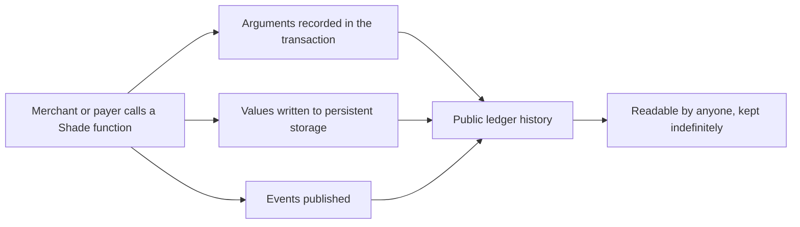

# Data privacy and on-chain data exposure

This page lists every field the `shade` and `account` contracts store or emit that holds merchant-supplied or user-linked data, and tells you what to keep off-chain. It is for [merchants](../glossary.md#merchant) and the developers who build their invoicing, checkout, and notification systems.

> **Security:** Everything Shade stores or emits is public and permanent. Do not put names, emails, phone numbers, physical addresses, order contents, or any other personal data in an invoice description, a webhook URL, or any other `String` argument. Use an opaque reference and keep the mapping off-chain. See [Never put this on-chain](#never-put-this-on-chain).

## Why it matters

Shade runs on Soroban, where contract storage and contract events are readable by anyone. Neither contract encrypts, hashes, or access-controls what it stores. A value you pass to a contract function becomes part of the public ledger, and the ledger history cannot be edited or deleted. A mistake in an invoice description is permanent.

## What is public

Three places expose data, and none of them is private:

1. **Contract storage.** Every storage entry in both contracts uses persistent storage (`env.storage().persistent()`); neither contract uses instance or temporary storage. Anyone can read the ledger entries through a Soroban RPC node, with or without calling Shade's getters. A getter such as `get_invoice` is a convenience, not an access check: `get_invoice`, `get_merchant`, and `get_user_transactions` in [`contracts/shade/src/shade.rs`](../../contracts/shade/src/shade.rs) take no authorization.
2. **Contract events.** Every `#[contractevent]` is recorded with its transaction. Indexers can read the events for as long as they keep history, and you cannot recall an event once it is emitted. See the [event indexing guide](../guides/indexing-events.md).
3. **Transaction arguments.** The arguments of every Shade call are part of the submitted transaction. A description you pass to `create_invoice`, `create_invoice_draft`, `create_fiat_invoice`, `create_invoice_signed`, or `amend_invoice` is public even where no event repeats it. This includes the description from a draft that is never finalized, and the old description of an invoice you later amend.

This diagram shows that every call writes to the public ledger through three routes, and none of them is restricted.

> **Note:** Token contracts that Shade accepts (SEP-41 tokens) publish their own transfer events. Those events are outside this repository, but they also link the payer address to the merchant account address and the amount.

## Inventory of public fields

Each table lists a field, its type, who supplies it, and why it is sensitive. "Supplied by" names the party whose input fills the field: the merchant, the payer, the admin, or the contract itself (ledger timestamps and counters). Source links point to the definition in the repository; line ranges are for the revision this page was written against. Sensitivity labels:

- **Identifier:** a Stellar address. It is pseudonymous, but becomes personal data once anyone connects it to a person or business.
- **Free text:** a `String` you control. It holds whatever you type, including personal data.
- **Commercial:** an amount, token, or fee that reveals prices, revenue, or terms.
- **Timing:** a ledger timestamp that supports correlation with off-chain records.

### `shade` contract: storage

All keys are variants of `DataKey` in [`contracts/shade/src/types.rs#L9-L46`](../../contracts/shade/src/types.rs). Value types are in the same file.

| Storage key | Field | Type | Supplied by | Why sensitive | Source |
|---|---|---|---|---|---|
| `Merchant(u64)` | `address` | `Address` | Merchant | Identifier: the merchant's account, tied to a merchant ID | [`types.rs#L65-L77`](../../contracts/shade/src/types.rs) |
| `Merchant(u64)` | `webhook` | `String` | Merchant | Free text: your notification URL, which can reveal your domain, internal host names, or secret tokens in the path or query string | [`types.rs#L71`](../../contracts/shade/src/types.rs) |
| `Merchant(u64)` | `auto_withdrawal_recipient` | `Option<Address>` | Merchant | Identifier: where your funds are swept, often your treasury or personal wallet | [`types.rs#L74`](../../contracts/shade/src/types.rs) |
| `Merchant(u64)` | `auto_withdrawal_thresholds` | `Vec<AutoWithdrawalThreshold>` (`token`, `threshold`) | Merchant | Commercial: reveals which tokens you hold and the balance at which you sweep | [`types.rs#L58-L61`](../../contracts/shade/src/types.rs) |
| `Merchant(u64)` | `date_registered` | `u64` | Contract | Timing: when you joined | [`types.rs#L70`](../../contracts/shade/src/types.rs) |
| `Merchant(u64)` | `id`, `active`, `verified` | `u64`, `bool`, `bool` | Contract / admin | Status flags: show whether the admin verified or deactivated you | [`types.rs#L66-L69`](../../contracts/shade/src/types.rs) |
| `MerchantId(Address)` | value | `u64` | Contract | Identifier: reverse lookup from merchant address to merchant ID | [`types.rs#L33`](../../contracts/shade/src/types.rs) |
| `MerchantKey(Address)` | value | `BytesN<32>` | Merchant | Identifier: your signing public key, linking signed invoices to you | [`types.rs#L31`](../../contracts/shade/src/types.rs) |
| `MerchantTokens(Address)` | value | `Vec<Address>` | Merchant | Commercial: which tokens you accept | [`types.rs#L34`](../../contracts/shade/src/types.rs) |
| `MerchantAccount(u64)` | value | `Address` | Contract | Identifier: your per-merchant vault contract, whose balances anyone can read | [`types.rs#L35`](../../contracts/shade/src/types.rs) |
| `MerchantPlatformFee(u64, Address)` | value | `i128` | Admin or fee operator | Commercial: your negotiated fee in basis points for a token | [`types.rs#L27`](../../contracts/shade/src/types.rs) |
| `Invoice(u64)` | `description` | `String` | Merchant (at creation or `amend_invoice`) | Free text: capped at 100 characters, otherwise unrestricted | [`types.rs#L122-L137`](../../contracts/shade/src/types.rs) |
| `Invoice(u64)` | `amount`, `amount_paid`, `amount_refunded` | `i128` | Merchant (`amount`), payer (`amount_paid`), contract | Commercial: price and payment history per invoice | [`types.rs#L125`](../../contracts/shade/src/types.rs) |
| `Invoice(u64)` | `token` | `Address` | Merchant | Commercial: payment token | [`types.rs#L126`](../../contracts/shade/src/types.rs) |
| `Invoice(u64)` | `merchant_id` | `u64` | Contract | Identifier: links the invoice to the merchant | [`types.rs#L128`](../../contracts/shade/src/types.rs) |
| `Invoice(u64)` | `payer` | `Option<Address>` | Payer (set on first payment) | Identifier: links the payer address to this invoice | [`types.rs#L129`](../../contracts/shade/src/types.rs) |
| `Invoice(u64)` | `date_created`, `date_paid`, `expires_at` | `u64`, `Option<u64>`, `Option<u64>` | Contract (`expires_at`: merchant) | Timing: when the order was made and paid | [`types.rs#L130-L134`](../../contracts/shade/src/types.rs) |
| `Invoice(u64)` | `fiat_pricing.currency` | `String` | Merchant | Free text: fiat currency code, from `create_fiat_invoice` | [`types.rs#L102-L106`](../../contracts/shade/src/types.rs) |
| `Invoice(u64)` | `fiat_pricing.amount`, `fiat_pricing.decimals` | `i128`, `u32` | Merchant | Commercial: the fiat price before conversion | [`types.rs#L102-L106`](../../contracts/shade/src/types.rs) |
| `Invoice(u64)` | `status`, `pricing_mode` | enums | Contract | Shows whether the invoice is paid, refunded, or cancelled | [`types.rs#L82-L98`](../../contracts/shade/src/types.rs) |
| `UserTransactions(Address)` | key address | `Address` | Payer | Identifier: the payer's full payment history is grouped under their address | [`history.rs#L4-L15`](../../contracts/shade/src/components/history.rs) |
| `UserTransactions(Address)` | `description` | `String` | Merchant (copied from the invoice) | Free text: a second public copy of the invoice description, filed under the payer | [`types.rs#L223-L231`](../../contracts/shade/src/types.rs) |
| `UserTransactions(Address)` | `amount`, `token`, `date`, `merchant_id`, `ref_id`, `transaction_type` | `i128`, `Address`, `u64`, `u64`, `u64`, enum | Payer, contract | Commercial and timing: what the payer paid, to which merchant, when, for which invoice | [`types.rs#L223-L231`](../../contracts/shade/src/types.rs) |
| `MerchantAnalytics(Address, Address)` | `merchant`, `token`, `total_volume`, `total_fees`, `transaction_count`, `last_updated` | `Address`, `Address`, `i128`, `i128`, `u64`, `u64` | Contract | Commercial: your revenue, fees paid, and sales count per token | [`types.rs#L175-L182`](../../contracts/shade/src/types.rs) |
| `MerchantAnalyticsSummary(Address)` | `merchant`, `total_volume`, `total_fees`, `transaction_count`, `last_updated` | `Address`, `i128`, `i128`, `u64`, `u64` | Contract | Commercial: your lifetime revenue across tokens | [`types.rs#L186-L192`](../../contracts/shade/src/types.rs) |
| `MerchantVolume(Address, Address)` | value | `i128` | Contract | Commercial: your volume per token | [`types.rs#L40`](../../contracts/shade/src/types.rs) |
| `UsedNonce(Address, BytesN<32>)` | key nonce | `BytesN<32>` | Merchant | Timing and linkability: shows how many signed invoices you created; do not derive the nonce from an order ID or customer data | [`signature_util.rs#L61-L79`](../../contracts/shade/src/components/signature_util.rs) |
| `Role(Address, Role)` | key address | `Address` | Admin | Identifier: staff or operator addresses holding Admin, Manager, or Operator roles | [`types.rs#L21`](../../contracts/shade/src/types.rs) |

The remaining `DataKey` variants hold protocol configuration set by the admin and contain no merchant or payer data: `ContractInfo`, `Admin`, `PendingAdmin`, `Paused`, `AcceptedTokens`, `ReentrancyStatus`, `AccountWasmHash`, `PlatformAccount`, `TokenFee`, `PendingTokenFee`, `TokenOracle`, `MerchantCount`, `InvoiceCount`, `TokenAnalytics`, and `TokenVolume`. `TokenAnalytics` and `TokenVolume` are aggregates per token and name no individual payer.

### `shade` contract: events

Events are defined in [`contracts/shade/src/events.rs`](../../contracts/shade/src/events.rs). No `shade` event carries an invoice `description`. Descriptions are exposed through storage and transaction arguments instead (see [What is public](#what-is-public)). The one event that carries merchant-supplied free text is `MerchantWebhookSetEvent`.

| Event | Fields with merchant or user-linked data | Supplied by | Why sensitive | Source |
|---|---|---|---|---|
| `MerchantRegisteredEvent` | `merchant: Address`, `merchant_id: u64`, `timestamp: u64` | Merchant | Identifier and timing: publishes the merchant's address and join date | [`events.rs#L33-L38`](../../contracts/shade/src/events.rs) |
| `MerchantAccountDeployedEvent` | `merchant: Address`, `contract: Address`, `timestamp: u64` | Contract | Identifier: links the merchant to the vault contract address | [`events.rs#L54-L59`](../../contracts/shade/src/events.rs) |
| `MerchantStatusChangedEvent` | `merchant_id: u64`, `active: bool` | Admin | Status: shows when a merchant is deactivated | [`events.rs#L75-L80`](../../contracts/shade/src/events.rs) |
| `MerchantVerifiedEvent` | `merchant_id: u64`, `status: bool` | Admin | Status: shows verification changes | [`events.rs#L171-L176`](../../contracts/shade/src/events.rs) |
| `MerchantWebhookSetEvent` | `merchant: Address`, `merchant_id: u64`, `webhook: String` | Merchant | Free text: the full URL, and every earlier URL you replaced, stays in event history | [`events.rs#L187-L193`](../../contracts/shade/src/events.rs) |
| `MerchantKeySetEvent` | `merchant: Address`, `key: BytesN<32>` | Merchant | Identifier: your signing key and every earlier key | [`events.rs#L211-L216`](../../contracts/shade/src/events.rs) |
| `MerchantTokensSetEvent`, `MerchantTokenRemovedEvent` | `merchant: Address`, `tokens: Vec<Address>` / `token: Address` | Merchant | Commercial: your accepted-token changes | [`events.rs#L714-L740`](../../contracts/shade/src/events.rs) |
| `InvoiceCreatedEvent` | `invoice_id: u64`, `merchant: Address`, `amount: i128`, `token: Address` | Merchant | Commercial: price of every invoice, linked to your address. Not emitted for drafts, but the draft is still in storage | [`events.rs#L96-L102`](../../contracts/shade/src/events.rs) |
| `InvoicePaidEvent` | `invoice_id`, `merchant_id`, `merchant_account: Address`, `payer: Address`, `amount`, `fee`, `merchant_amount`, `token`, `timestamp` | Payer | Identifier and commercial: links the payer address to the merchant, the invoice, the amount, and the time | [`events.rs#L425-L436`](../../contracts/shade/src/events.rs) |
| `FiatInvoicePricedEvent` | `invoice_id`, `token: Address`, `resolved_amount: i128`, `timestamp` | Contract | Commercial: the converted amount per quote refresh | [`events.rs#L465-L471`](../../contracts/shade/src/events.rs) |
| `PaymentSplitRoutedEvent` | `invoice_id`, `merchant_account: Address`, `platform_account: Address`, `merchant_amount`, `platform_amount`, `token`, `timestamp` | Contract | Commercial: your net revenue and the fee split | [`events.rs#L489-L498`](../../contracts/shade/src/events.rs) |
| `PlatformFeeRoutedEvent` | `route_kind: u32`, `ref_id`, `merchant_id`, `merchant: Address`, `merchant_account: Address`, `platform_account: Address`, `payer: Address`, `gross_amount`, `platform_fee`, `merchant_amount`, `token`, `fee_bps_applied`, `timestamp` | Payer, contract | Identifier and commercial: a second payer-to-merchant link with full amounts | [`events.rs#L522-L537`](../../contracts/shade/src/events.rs) |
| `InvoiceRefundedEvent`, `InvoicePartiallyRefundedEvent` | `invoice_id`, `merchant: Address`, `amount`, `total_amount_refunded` (partial only), `timestamp` | Merchant | Commercial: refund amounts and timing | [`events.rs#L120-L151`](../../contracts/shade/src/events.rs) |
| `InvoiceExpiredRefundEvent` | `invoice_id`, `buyer: Address`, `amount`, `token`, `timestamp` | Payer | Identifier: links the payer address to a refunded invoice | [`events.rs#L885-L892`](../../contracts/shade/src/events.rs) |
| `InvoiceCancelledEvent` | `invoice_id`, `merchant: Address`, `timestamp` | Merchant | Timing: when you voided an invoice | [`events.rs#L624-L629`](../../contracts/shade/src/events.rs) |
| `InvoiceAmendedEvent` | `invoice_id`, `merchant: Address`, `old_amount`, `new_amount`, `timestamp` | Merchant | Commercial: both prices stay public. The description change appears only in the transaction arguments | [`events.rs#L645-L652`](../../contracts/shade/src/events.rs) |
| `NonceInvalidatedEvent` | `merchant: Address`, `nonce: BytesN<32>`, `timestamp` | Merchant | Linkability: the nonce is public the moment you use it | [`events.rs#L672-L677`](../../contracts/shade/src/events.rs) |
| `AutoWithdrawThresholdEvent` | `merchant_id`, `token: Address`, `threshold: i128` | Merchant | Commercial: your sweep threshold | [`events.rs#L756-L761`](../../contracts/shade/src/events.rs) |
| `AutoWithdrawRecipientEvent` | `merchant_id`, `recipient: Address` | Merchant | Identifier: your payout address | [`events.rs#L777-L781`](../../contracts/shade/src/events.rs) |
| `AutoWithdrawalTriggeredEvent`, `AutoWithdrawalFailedEvent` | `merchant_id`, `token: Address`, `amount: i128`, `recipient: Address` | Contract | Identifier and commercial: each sweep to your payout address | [`events.rs#L795-L825`](../../contracts/shade/src/events.rs) |
| `AccountRestrictedEvent` | `merchant: Address`, `status: bool`, `caller: Address`, `timestamp` | Admin | Status: shows when your vault is restricted | [`events.rs#L401-L407`](../../contracts/shade/src/events.rs) |
| `MerchantPlatformFeeSetEvent`, `PlatformFeeClearedEvent` | `caller: Address`, `merchant_id`, `token: Address`, `fee_bps` (set only), `timestamp` | Admin or fee operator | Commercial: your negotiated fee terms | [`events.rs#L573-L606`](../../contracts/shade/src/events.rs) |
| `InvoiceSearchExecutedEvent` | `caller: Address`, `count: u32`, `has_next: bool`, `timestamp` | Caller | Identifier and behavior: shows which address ran an invoice search | [`events.rs#L912-L918`](../../contracts/shade/src/events.rs) |
| `RoleGrantedEvent`, `RoleRevokedEvent` | `admin: Address`, `user: Address`, `role`, `timestamp` | Admin | Identifier: staff addresses and their roles | [`events.rs#L232-L262`](../../contracts/shade/src/events.rs) |

The remaining `shade` events are admin or protocol operations and contain no merchant or payer data: `InitalizedEvent`, `TokenAddedEvent`, `TokenRemovedEvent`, `ContractPausedEvent`, `ContractUnpausedEvent`, `FeeProposedEvent`, `FeeSetEvent`, `PlatformAccountSetEvent`, `TokenOracleSetEvent`, `ContractUpgradedEvent`, `AccountWasmHashSetEvent`, `AdminTransferProposedEvent`, and `AdminTransferAcceptedEvent`. They expose admin addresses.

### `account` contract: storage

The `account` contract is the per-merchant vault, defined in [`contracts/account/src`](../../contracts/account/src). Keys are `DataKey` variants in [`contracts/account/src/types.rs#L3-L15`](../../contracts/account/src/types.rs).

| Storage key | Field | Type | Supplied by | Why sensitive | Source |
|---|---|---|---|---|---|
| `Merchant` | value | `Address` | Contract (set at initialization) | Identifier: the vault owner | [`account.rs#L60-L80`](../../contracts/account/src/account.rs) |
| `Manager` | value | `Address` | Contract (set at initialization) | Identifier: the manager that co-approves withdrawals | [`account.rs#L60-L80`](../../contracts/account/src/account.rs) |
| `AccountInfo` | `merchant`, `manager`, `merchant_id`, `date_created` | `Address`, `Address`, `u64`, `u64` | Contract | Identifier and timing: a second copy of the merchant-to-vault link | [`types.rs#L19-L24`](../../contracts/account/src/types.rs) |
| `TrackedTokens` | value | `Vec<Address>` | Merchant | Commercial: tokens the vault holds | [`account.rs#L24-L29`](../../contracts/account/src/account.rs) |
| `WithdrawalAnalytics(Address)` | `token`, `total_withdrawn`, `withdrawal_count`, `last_withdrawn_at` | `Address`, `i128`, `u64`, `u64` | Contract | Commercial and timing: how much you withdraw and when | [`types.rs#L35-L40`](../../contracts/account/src/types.rs) |
| `Threshold` | value | `i128` | Merchant | Commercial: the amount above which a withdrawal needs a second approval | [`account.rs#L268`](../../contracts/account/src/account.rs) |
| `WithdrawalRequest(u64)` | `recipient` | `Address` | Merchant | Identifier: where each large withdrawal goes | [`types.rs#L44-L51`](../../contracts/account/src/types.rs) |
| `WithdrawalRequest(u64)` | `amount`, `token` | `i128`, `Address` | Merchant | Commercial: withdrawal size and token | [`types.rs#L44-L51`](../../contracts/account/src/types.rs) |
| `WithdrawalRequest(u64)` | `approvals` | `Vec<Address>` | Merchant, manager | Identifier: who approved | [`types.rs#L44-L51`](../../contracts/account/src/types.rs) |
| `Verified`, `Restricted`, `WithdrawalCount` | value | `bool`, `bool`, `u64` | Admin, contract | Status flags and a counter | [`types.rs#L3-L15`](../../contracts/account/src/types.rs) |

### `account` contract: events

Events are defined in [`contracts/account/src/events.rs`](../../contracts/account/src/events.rs).

| Event | Fields with merchant or user-linked data | Supplied by | Why sensitive | Source |
|---|---|---|---|---|
| `AccountInitializedEvent` | `merchant: Address`, `merchant_id: u64`, `timestamp` | Contract | Identifier: links the vault to the merchant | [`events.rs#L3-L8`](../../contracts/account/src/events.rs) |
| `WithdrawalToEvent` | `token`, `merchant: Address`, `recipient: Address`, `amount: i128`, `timestamp` | Merchant | Identifier and commercial: each payout destination and amount | [`events.rs#L77-L84`](../../contracts/account/src/events.rs) |
| `RefundProcessedEvent` | `token`, `amount: i128`, `recipient: Address`, `timestamp` | Manager | Identifier: links the refund recipient `to` address (normally the payer) to an amount | [`events.rs#L43-L49`](../../contracts/account/src/events.rs) |
| `PendingWithdrawalCreatedEvent` | `id`, `token`, `amount`, `recipient: Address`, `initiator: Address`, `timestamp` | Merchant | Identifier and commercial: a large withdrawal waiting for approval | [`events.rs#L104-L112`](../../contracts/account/src/events.rs) |
| `WithdrawalApprovedEvent` | `id`, `approver: Address`, `timestamp` | Manager | Identifier: who approved | [`events.rs#L134-L139`](../../contracts/account/src/events.rs) |
| `WithdrawalExecutedEvent` | `id`, `timestamp` | Contract | Timing: when the withdrawal ran | [`events.rs#L150-L154`](../../contracts/account/src/events.rs) |
| `WithdrawalThresholdSetEvent` | `threshold: i128`, `timestamp` | Merchant | Commercial: your approval threshold | [`events.rs#L160-L164`](../../contracts/account/src/events.rs) |
| `TokenAddedEvent` | `token: Address`, `timestamp` | Merchant | Commercial: tokens the vault tracks | [`events.rs#L67-L71`](../../contracts/account/src/events.rs) |
| `AccountRestrictedEvent`, `AccountVerifiedEvent` | `status: bool` (restricted only), `timestamp` | Admin | Status: restriction and verification times | [`events.rs#L24-L37`](../../contracts/account/src/events.rs) |

### Named in the issue but not in the code

Issue #552 lists ticket holders and waitlists. Neither exists in the compiled contracts at this revision:

- **Ticket holders.** No `Ticket` type, ticket storage key, or ticket event exists in [`contracts/shade/src/types.rs`](../../contracts/shade/src/types.rs) or [`contracts/shade/src/events.rs`](../../contracts/shade/src/events.rs). The only trace is the enum variant `PlatformFeeRouteKind::TicketPurchase` (`route_kind = 2` in `PlatformFeeRoutedEvent`), which no storage key or function uses to hold a ticket holder.
- **Waitlists.** No waitlist type, key, function, or event exists in either contract.
- **Subscriptions.** `TransactionType::SubscriptionCharge` and `PlatformFeeRouteKind::Subscription` exist as enum variants only. No subscription storage or event exists.

If these features are added later, extend the inventory above in the same pull request: ticket holder addresses and waitlist entries would be public by the same rules.

## Never put this on-chain

Never put any of the following in a `description`, a `webhook` value, a fiat currency string, or any other argument to a Shade function:

- Names, including a business name that identifies a private individual.
- Email addresses and phone numbers.
- Physical addresses, including shipping and billing addresses.
- Order contents, such as product names, SKUs, prescriptions, or service details that reveal what a person bought.
- Free-text notes about a customer.
- Government IDs, tax IDs, and account numbers.
- Secrets in a webhook URL, such as an API key, token, or password in the path or query string.
- Anything derived from the above in a way someone could reverse, such as an unsalted hash of an email address.

> **Warning:** A hash of low-entropy data is not private. Someone can hash every plausible email address or phone number and compare the results. Use a random value instead.

### Use an opaque reference

Put a random identifier in the description and keep the mapping in your own database.

| Instead of | Put on-chain | Keep off-chain |
|---|---|---|
| `Order for Jane Roe, 12 Elm St, 2x blue shirt` | `order-7f3a9c2e` | Order record: customer, address, items, keyed by `order-7f3a9c2e` |
| `Invoice for jane@example.com` | `inv-b81d04aa` | Customer record keyed by `inv-b81d04aa` |
| `https://hooks.example.com/shade?token=abc123` | `https://hooks.example.com/shade` | The token, stored in your notifier's configuration |

Generate the reference with a cryptographically secure random source (at least 64 bits). Do not use a sequential number, a timestamp, or a hash of customer data, because those are guessable or linkable. If you need to prove later that a reference belongs to an order, sign or hash the reference together with a secret salt that you keep off-chain, and share the salt only with the party you are proving it to.

The description limit is 100 characters (`description.len() > 100` check in [`contracts/shade/src/components/invoice.rs#L90`](../../contracts/shade/src/components/invoice.rs)). A short opaque reference fits easily.

## Immutability and data protection law

You cannot delete on-chain data. Storage entries stay readable in ledger history, events stay in every indexer's archive, and transaction arguments stay in the transaction record. Overwriting a value, as `amend_invoice` or `set_merchant_webhook` does, changes the current storage entry but not the earlier transaction or event.

This conflicts with data protection rules such as the EU General Data Protection Regulation (GDPR):

- **Right to erasure.** A request to erase personal data cannot be honored for data you put on-chain. No admin function, upgrade, or merchant call removes ledger history.
- **Controller responsibility.** If you choose what goes into a description or webhook, you decide the purpose and means of that data, so you may carry the controller's obligations for it. The contracts hold your customers' personal data only if you put it on-chain.
- **Wallet addresses.** A Stellar address can count as personal data when it is linked to an identifiable person, directly or by combining it with other data (see [Linkability risks](#linkability-risks)).

The practical rule is: keep personal data off-chain, where you can delete it, and put only opaque references on-chain. If you need to erase a customer, delete the off-chain record. The reference left on-chain then points to nothing.

> **Note:** This page describes how the contracts behave. It is not legal advice. Ask a lawyer how data protection law applies to your business and jurisdiction.

## Linkability risks

Even with clean descriptions, public data lets an observer connect activity. These risks exist because of fields in the inventory above.

| Risk | How it works | Fields involved |
|---|---|---|
| Payer address reuse across merchants | A payer who uses one address for several merchants has all those payments linked under one `UserTransactions(Address)` key, and in each `InvoicePaidEvent` and `PlatformFeeRoutedEvent`. | `payer`, `merchant_id`, `UserTransactions` |
| Merchant exposure from payer history | `get_user_transactions` returns a payer's history, including the invoice descriptions, with no authorization. A description you write is shown to every address that reads that payer's history. | `UserTransactions.description` |
| Amount and timestamp correlation | An observer who knows a price and a purchase time can match it to one invoice. Unusual amounts, such as `19.37`, point to one order. | `amount`, `date_paid`, `timestamp` |
| Analytics correlation | Per-merchant volume, fees, and sale counts are public and update on every payment. A watcher can infer your revenue and detect each sale by watching `MerchantAnalytics` change. | `MerchantAnalytics`, `MerchantAnalyticsSummary` |
| Event indexing | Indexers combine events with token transfer events, exchange deposit records, and social posts to attach names to addresses. | All events |
| Sequential IDs | Invoice IDs and merchant IDs are counters, so an observer can estimate your share of all invoices and enumerate every invoice. | `InvoiceCount`, `MerchantCount` |
| Payout address reuse | Reusing your auto-withdrawal or withdrawal recipient address across businesses links them. | `auto_withdrawal_recipient`, `WithdrawalToEvent` |

### Mitigations

- **Use a fresh payer address per merchant or per purchase,** and fund it just before paying. Avoid funding it from an address tied to your identity or an exchange account.
- **Avoid unique amounts.** Charge standard prices, and do not encode an order number in the amount.
- **Round amounts** to common price points, so many orders share the same amount.
- **Use opaque references** and minimal descriptions, such as `order-7f3a9c2e`, or a generic text shared by many invoices.
- **Separate roles with separate addresses.** Use different addresses for your merchant identity, your payout recipient, and your staff roles.
- **Do not reuse a webhook URL across businesses,** and do not put a customer or tenant name in its host or path.
- **Assume your revenue is public.** The analytics keys cannot be hidden. If revenue must stay private, do not use the protocol for that revenue.

## Merchant checklist

Before you go live, confirm each item:

- [ ] Every invoice description is an opaque reference or generic text, never a name, email, address, or order contents.
- [ ] The opaque reference is random, not sequential and not a hash of customer data.
- [ ] The webhook URL holds no secrets and no customer or tenant names.
- [ ] You keep the reference-to-customer mapping in an off-chain store where you can delete records.
- [ ] You use drafts only for the same safe text; a draft description is public even if you never finalize.
- [ ] Your nonces for `create_invoice_signed` are random, not derived from order or customer data.
- [ ] Your support and privacy policies tell customers that payer addresses and amounts are public and permanent.
- [ ] You use a payout address that is not tied to your personal identity if you do not want your treasury linked to you.
- [ ] A lawyer reviewed how data protection law applies to your use.

## Related pages

- [Threat model and security assumptions](threat-model.md) — assets, attacker classes, and attack surfaces.
- [Invoice lifecycle and statuses](../concepts/invoice-lifecycle.md) — creation paths and the `Invoice` struct.
- [Merchant webhooks and off-chain notifications](../guides/webhooks.md) — what the webhook field stores and emits.
- [Event indexing guide](../guides/indexing-events.md) — how indexers read the event stream.
- [Data types reference](../reference/data-types.md) — type definitions for the stored values.
- [Events reference](../reference/events.md) — every event payload.
- [Protocol glossary](../glossary.md) — terms used on this page.

← [Back to security](README.md)
